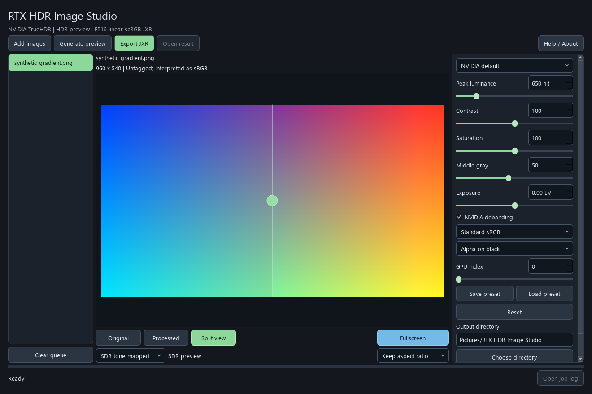

# RTX HDR Image Studio

A local Windows desktop application that applies NVIDIA TrueHDR to SDR still images, previews the result in native HDR, and exports verified FP16 linear scRGB JPEG XR (`.jxr`) files.

**AI disclosure:** This project was created by **OpenAI Codex (ChatGPT)** under the direction of **TeddyWEinzbern**. The implementation, documentation, and tests were written with AI assistance. It is an independent community project, not an official NVIDIA or OpenAI product. See [AUTHORS.md](AUTHORS.md).



The illustration uses a generated test image and an SDR preview. It is not a measurement of HDR display output.

## Features

- English GUI with drag-and-drop, batch processing, presets, and cancellation.
- Peak luminance, contrast, saturation, middle gray, debanding, exposure, and GPU selection.
- Native Direct3D 11 FP16/scRGB HDR preview, split comparison, and SDR tone-mapped fallback.
- EXIF orientation and embedded ICC input conversion to sRGB; explicit alpha compositing.
- Full-resolution FP16 JXR export with exact decoded-sample verification and collision-safe filenames.
- Separate GPU worker process, so a native SDK failure does not take down the interface.
- No bundled Python, CUDA, NVIDIA binaries, automatic installer, downloader, or updater.

## Hardware and software

| Component | Requirement |
| --- | --- |
| Operating system | Windows 11 x64. Windows 11 24H2 or newer is recommended for explicit HDR/ACM detection. Linux and macOS desktop operation are not supported. |
| Python | CPython 3.12 x64; other Python versions are not currently supported by this package. |
| Processing GPU | An NVIDIA RTX GPU supported by the NVIDIA VFX TrueHDR SDK. GeForce RTX 20/30/40/50-series desktop and laptop GPUs are the intended device families; support remains subject to the current NVIDIA SDK and driver. AMD, Intel, GTX-only, and CPU-only inference are not supported. |
| Driver | A driver compatible with the selected CUDA 13 runtime (R580 or newer). A newer VFX release may impose a higher requirement. |
| VRAM | No universal minimum is claimed. An 8 GB RTX 3070 Ti Laptop GPU was used for validation; larger images require more VRAM. Input is limited to 40 megapixels. |
| Display | Any display for SDR previews and export. An HDR-capable display with **Windows HDR enabled** is required for native HDR preview. An HDR monitor is not required to run inference. ACM alone does not enable HDR highlights. |

The verified development configuration is an RTX 3070 Ti Laptop GPU (8 GB), driver 621.01, Windows 11, CPython 3.12, and `nvidia-vfx` 0.2.0.0. Other device families are intended compatibility targets, not individually tested configurations.

Check the upstream [NVIDIA Windows requirements](https://docs.nvidia.com/maxine/vfx/latest/WindowsVFXSDK/GetStartedonWindows.html), [TrueHDR performance/device examples](https://docs.nvidia.com/maxine/vfx/latest/WindowsVFXSDK/PerformanceReference.html), and [CuPy installation guide](https://docs.cupy.dev/en/stable/install.html) when selecting hardware and drivers.

## Manual installation

The application never installs dependencies. Run the following commands yourself in a terminal. Do not run them inside the Python interactive prompt.

1. Install [Python 3.12 x64](https://www.python.org/downloads/) and a compatible [NVIDIA graphics driver](https://www.nvidia.com/Download/index.aspx).
2. Download this repository's ZIP and extract it, or clone it:

   ```powershell
   git clone https://github.com/TeddyWEinzbern/rtx-hdr-image-studio.git
   cd rtx-hdr-image-studio
   ```

3. Create an isolated environment and install the application and GPU dependencies:

   ```powershell
   py -3.12 -m venv .venv
   .\.venv\Scripts\python.exe -m pip install --upgrade pip
   .\.venv\Scripts\python.exe -m pip install ".[gpu]"
   ```

   Activation is optional; these commands address the environment directly. The first installation downloads large third-party GPU packages. Review their licenses before installation. A full system CUDA Toolkit is generally unnecessary for this tested wheel-based configuration: CUDA runtime/NVRTC packages are declared in the `gpu` extra. The NVIDIA graphics driver must still be installed separately.

4. Launch:

   ```powershell
   .\.venv\Scripts\pythonw.exe -m rtx_hdr_studio
   ```

   For startup diagnostics, use `python.exe` instead of `pythonw.exe`. An optional `rtx-hdr-studio.exe` GUI entry point is also created in `.venv\Scripts` by pip.

### Dependencies

The complete declarations are in [pyproject.toml](pyproject.toml). Base dependencies are NumPy, Pillow, PySide6 Essentials, and imagecodecs. The `gpu` extra adds CuPy for CUDA 13, CUDA Pathfinder, CUDA runtime/NVRTC wheels, and the pinned Windows `nvidia-vfx` wheel from NVIDIA's package server. The NVIDIA wheel URL includes a SHA-256 hash.

To install only the interface and CPU-testable components, use `pip install .` instead of `pip install ".[gpu]"`. Processing will report missing GPU dependencies until the GPU extra is installed. Do not install multiple conflicting CuPy distributions in the same environment.

## Use

1. Choose **Add images**, or drop PNG/JPEG/WebP/BMP/TIFF files into the window.
2. Choose a preset or adjust the parameters.
3. Choose **Generate preview**. Drag the divider or choose Original/Processed.
4. Leave **Automatic HDR** selected for native HDR, or select **SDR tone-mapped**.
5. Choose **Export JXR** to export the queue with the current settings.

Parameter changes do not automatically re-run inference; an outdated preview is labeled. Preview caches are reduced to a 1600-pixel longest edge, while inference and export retain the input dimensions. The application does not resize, crop, or adapt exported images to a screen.

| Parameter | Range | Default |
| --- | --- | --- |
| Peak luminance | 400–2000 nit | 650 |
| Contrast | 0–200 | 100 |
| Saturation | 0–200 | 100 |
| Middle gray | 10–100 | 50 |
| Debanding | On/off | On |
| Input exposure | -3 to +3 EV | 0 |
| Input transfer | sRGB / gamma 2.2 | sRGB |
| Alpha background | Black / white | Black |
| GPU index | 0–15 | 0 |

Use the actual CUDA device index when multiple GPUs are installed. Setting a larger target peak does not guarantee that the image or display reaches that peak. Presets are JSON files. A `.settings.json` sidecar records each export's processing parameters, source path, color profile description, GPU, and statistics.

Shortcuts: **Ctrl+O** adds images, **Ctrl+R** generates a preview, and **Ctrl+E** exports the queue. Existing files are preserved; repeated names gain a numeric suffix. Cancel stops the worker and keeps completed files. Closing the window stops its active worker.

## Color pipeline and limitations

Input ICC profile → sRGB RGB8 → linear-light exposure → Rec.709/gamma 2.2 input → NVIDIA TrueHDR RGB10A2 BT.2020/PQ → absolute luminance → linear scRGB → FP16 JXR.

- scRGB uses `1.0 = 80 nit`. Negative channels and values above 1 are preserved; they are needed for wide gamut and HDR. Native preview uses an FP16 swap chain with linear scRGB color space. The original side is adjusted to the Windows SDR reference-white level.
- This is an SDR enhancement tool, not a color-faithful P3 container converter or an HDR source editor. NVIDIA's RGB8 input path does not retain the full precision of 16-bit SDR sources. Unsupported or invalid ICC profiles produce an error rather than a silent conversion.
- **Windows HDR wallpaper compatibility is not guaranteed.** In development, a 5120×2880 JXR appeared gray as wallpaper, while a manually prepared 2560×1600 version displayed correctly on a 2560×1600 screen. Windows resizing/cropping may take a path that loses HDR. This is a configuration-specific observation, not a universal size limit. Prepare suitable source dimensions yourself and use a suitable Windows wallpaper mode. This application deliberately does not manage wallpaper sizing or change the wallpaper.
- A JXR that decodes correctly is not proof that every Windows viewer or wallpaper path will preserve HDR. FP16 JXR export is retained by design. Ordinary screenshots of the preview can be SDR tone-mapped and do not prove display brightness.
- Display calibration, panel capabilities, Windows color management, and drivers affect actual appearance. This application does not change Windows HDR, ACM, calibration, or display settings.
- Processing is local. Application code contains no image upload or telemetry path. Third-party dependencies have their own behavior and licenses.

## Files and logs

Default exports: `Pictures\RTX HDR Image Studio` under the current user's home directory. Choose another output directory in the UI.

Logs and preview caches: `%LOCALAPPDATA%\RTX HDR Image Studio\cache`. They can include input filenames and local paths. Delete caches manually while the application is closed when no longer needed. Set `RTX_HDR_STUDIO_HOME` to override the local application-data directory. Logs, caches, user images, and export sidecars should not be committed or attached to public issues without reviewing them.

## Development

See [CONTRIBUTING.md](CONTRIBUTING.md), [architecture](docs/architecture.md), and [testing](docs/testing.md). The repository contains no dependency-installation scripts or prepackaged proprietary runtimes. The small core tests use generated fixtures; real GPU/native tests are explicitly opt-in. CI is not a substitute for an HDR-capable display and RTX hardware.

## License and attribution

Project-authored code and documentation are available under the [MIT License](LICENSE). Third-party dependencies are not relicensed by this project; see [THIRD_PARTY.md](THIRD_PARTY.md). NVIDIA, RTX, ChatGPT, and Codex are names belonging to their respective owners. AI authorship attribution does not imply endorsement.
